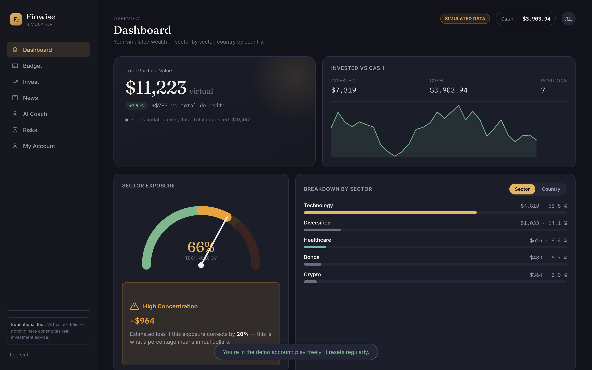
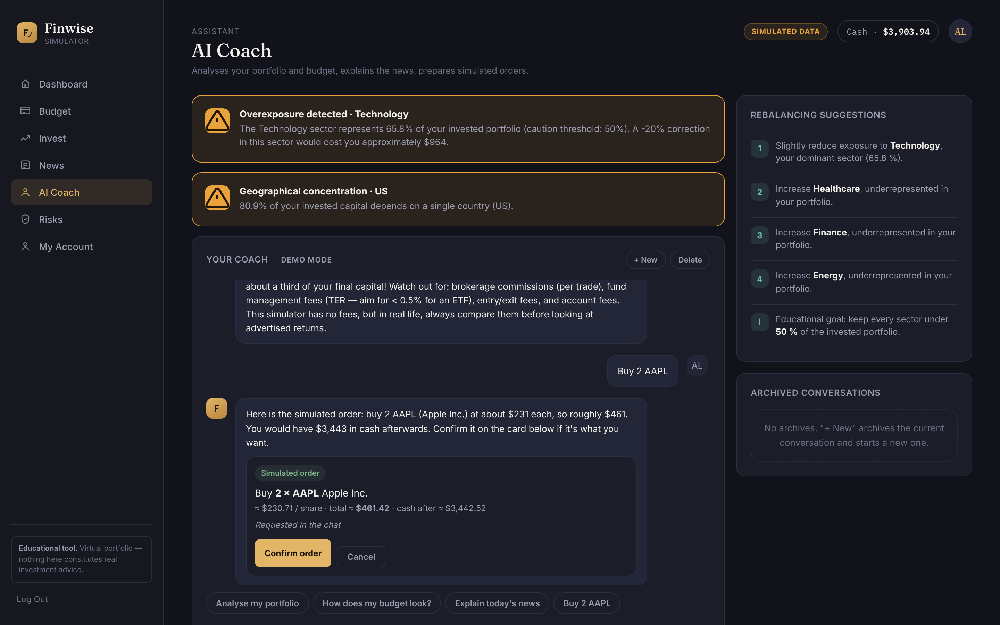
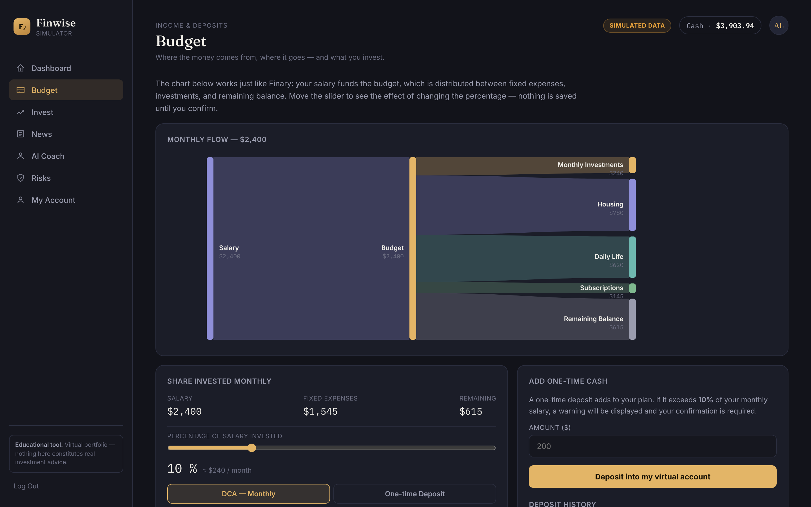
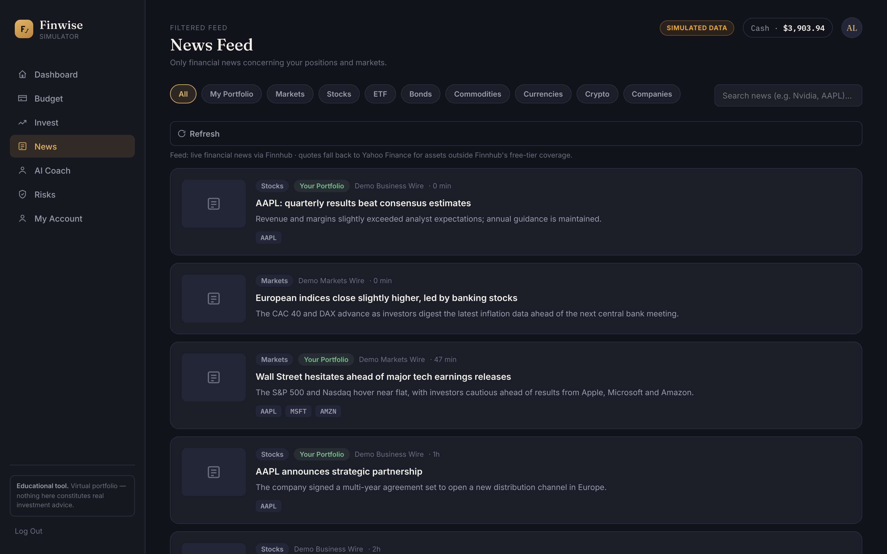
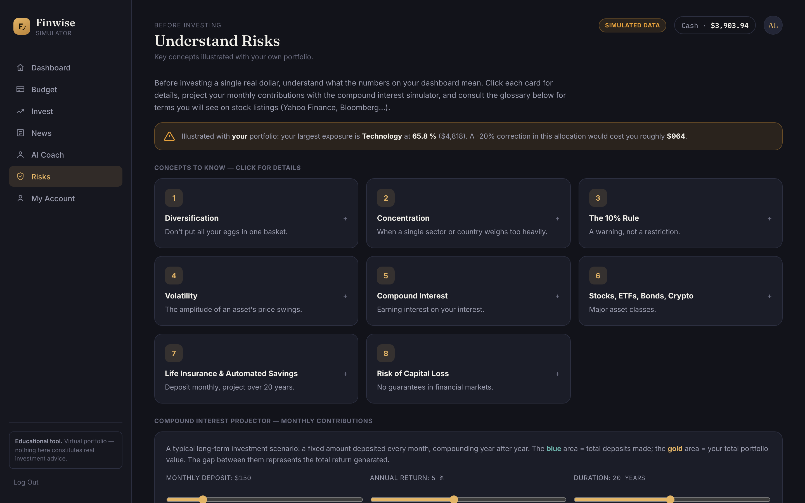

# Finwise

**Learn to invest without risking a cent.** Finwise is a portfolio simulator for students and young people: virtual money, real market prices, a budget planner, and an AI coach that analyses your portfolio and budget, explains the news, and prepares simulated orders you confirm in one click.

**Live demo:** _link coming soon_ · click **Try the live demo** to land on a pre-filled account, no sign-up needed.



## Features

- **Virtual portfolio on real prices**: stocks (US and Europe), ETFs, bonds and crypto, with fractional shares. Quotes refresh every 15 seconds without reloading the page.
- **AI coach**: reads your positions, budget, quotes and news through tools, turns risk into dollar amounts ("a 20% drop in tech would cost you about $964"), explains a headline in plain words and links it to what you hold, and proposes buy or sell orders that only run after you press **Confirm**.
- **Budget planner**: income and spending shown as a flow chart (salary → housing, daily life, subscriptions, investing, what's left), with a monthly investing plan (DCA). Investing more than 10% of income requires an explicit confirmation, enforced on the server.
- **Risk dashboard**: exposure by sector, country and asset class, concentration alerts, a compound-interest projector, and a glossary of key concepts.
- **News**: market news by category (stocks, ETFs, bonds, commodities, currencies, crypto) and a feed about the assets you hold. "Ask the coach" on any article gets you an explanation.
- **Works with zero API keys**: without keys, market data and news are simulated and the coach answers with a rules engine, so the app always runs for a demo.

| Coach | Budget |
|---|---|
|  |  |
| **News** | **Risk** |
|  |  |

## How the coach works

The coach is a tool-use loop on a large language model API (`server/services/coach.js`). The model never sees the database directly: it calls six tools that run the same server code as the rest of the app.

| Tool | What it returns |
|---|---|
| `get_portfolio` | Positions, cash, gains, breakdowns, concentration alerts |
| `get_budget` | Income, spending categories, investing plan, recent deposits |
| `get_quote` / `search_assets` | Current price and profile of an asset |
| `get_news` | Recent headlines, optionally only about held assets |
| `propose_order` | Checks cash or shares and prices the order, **without executing it** |

Proposed orders come back to the browser as cards. The trade only happens when the user clicks **Confirm**, through the regular order endpoint, at the server-side price. Guardrails: a system prompt that keeps the coach educational and grounded in tool data, per-user and global daily caps on API calls (past them the coach switches to demo mode), rate limiting, and an automatic fallback to the rules engine if the API is unreachable.

## Run it locally

Requires Node.js 20 or later.

```bash
npm install
cp .env.example .env   # optional: add your keys
npm start              # http://localhost:3000
```

On every start the server rebuilds a demo account (`demo@finwise.app` / `finwise-demo`) with a budget, seven positions and six months of history.

### API keys (all optional)

| Variable | Purpose | Where to get it |
|---|---|---|
| `ANTHROPIC_API_KEY` | AI coach | [console.anthropic.com](https://console.anthropic.com) (pay as you go) |
| `ANTHROPIC_MODEL` | Coach model, `claude-opus-5-5` by default | `claude-sonnet-5-5` costs about half |
| `FINNHUB_API_KEY` | Real-time US quotes and real news | [finnhub.io](https://finnhub.io) (free) |
| `TWELVEDATA_API_KEY` | Fallback for European and Asian quotes | [twelvedata.com](https://twelvedata.com) (free) |
| `JWT_SECRET` | Signs session cookies, required in production | `node -e "console.log(require('crypto').randomBytes(48).toString('hex'))"` |
| `ADMIN_EMAIL` | The account that signs up with this email becomes admin | |

See [`.env.example`](.env.example) for the full list.

## Deploy

The repo includes a [Render](https://render.com) blueprint (`render.yaml`) for the free plan: **New → Blueprint**, pick this repo, then paste your API keys when asked. On the free plan the instance sleeps after 15 minutes without traffic (the first visit then takes about 50 seconds) and the SQLite file is reset on each restart, which is fine for a demo since the demo account is rebuilt at boot.

## Architecture

```
server/
  index.js              Express, Helmet (strict CSP), routes, central error handler
  db.js                 SQLite (better-sqlite3): users, budgets, plans, deposits,
                        holdings, transactions; orders run in one atomic transaction
  seed.js               Demo account rebuilt at boot
  middleware/auth.js    JWT in an httpOnly, SameSite=Strict cookie
  routes/               auth, account, admin, budget, portfolio, market, news + coach
  services/
    coach.js            LLM tool-use loop (tools, system prompt, order proposals)
    agent.js            Deterministic portfolio analysis + demo-mode rules engine
    market.js           Finnhub → Yahoo → Twelve Data → simulated quotes, with caches
    news.js             Multi-category news + personalised feed, demo fallback
public/                 Vanilla JS single-page app (no build step)
```

**Security:** bcrypt password hashes, JWT in httpOnly cookies, Helmet with a strict Content Security Policy, rate limits on login, chat and news, input validation on every route, execution prices always computed on the server, no stack traces sent to the client, and the shared demo account cannot change its credentials or delete itself.

## Origin

I came up with the idea for Finwise and first built it with a student team in Barcelona. This repository is my own continuation of the project: I rebuilt the AI agent into a coach with tools and order confirmation, added the demo account, and deployed it.

## Disclaimer

Finwise is an educational simulator. All money is virtual and nothing in the app, including the coach's answers, is financial advice.
